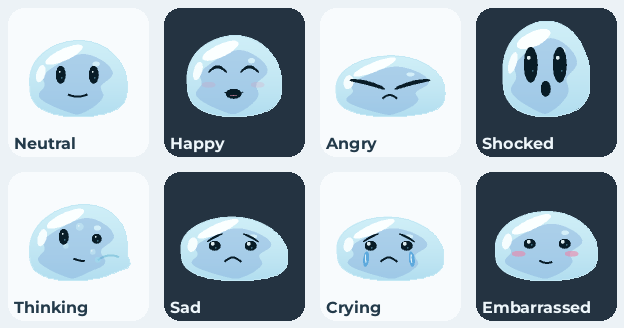
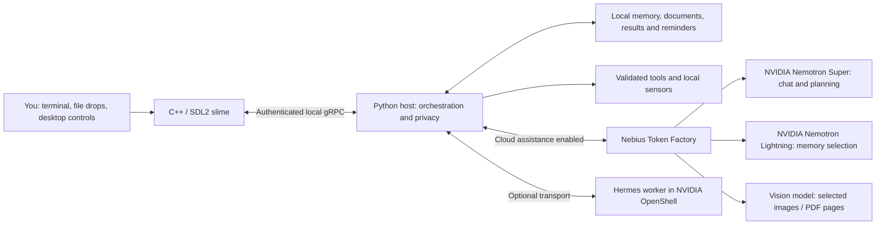

# 🫧 Project Blob

**A desktop companion that remembers your context, helps with your work, and lets you decide what it can see.**

Built for the **NVIDIA × Nebius Global AI Hackathon — Personal AI Track**, powered by **NVIDIA Nemotron** through **Nebius Token Factory**.



*Previews from Blob's C++ renderer. The running slime is drawn and animated from code.*

[What makes Blob different](#what-makes-blob-different) · [NVIDIA and Nebius](#built-with-nvidia-and-nebius) · [Setup](#setup) · [Run](#running-blob) · [Try it](#try-a-complete-workflow) · [Testing](#testing-and-evidence)

## The idea

A useful personal assistant needs continuity: your preferred name, your current subjects, the document you were working on, and the reminder you set yesterday. It also needs to know when to help, when to listen, and when to leave something alone.

Blob brings that continuity onto the desktop as a small blue slime with expressive eyes, a moving jelly body, and a terminal you can open whenever you need it. It can help you understand a lesson, turn a PDF into a study plan, remember a preference, or schedule a reminder. Its appearance responds to the conversation, and local interactions make it feel present between tasks.

**Our aim is a companion that becomes more useful as it gets to know you, while keeping observation and actions under your control.** We are building for students, developers, and people who spend long hours working at a computer. The current release is a Linux desktop beta.

## What makes Blob different

| Part of the experience | What Blob actually does |
| --- | --- |
| **A visible personality** | The C++/SDL2 slime follows the cursor, wobbles when poked or dragged, and changes expression with the conversation. Reduced-motion support is available. |
| **Memory with a source** | Local conversation archives, expiring project/event memories, and lasting preferences preserve the user's original words. Corrections supersede older facts; explicit naming instructions are saved immediately. |
| **Context across tasks** | Selected PDFs and images can inform answers. Saved subject lists personalize timetable questions, and generated plans can be replayed after a restart—even after their source files are deleted. |
| **Optional screen awareness** | Local OCR produces a short-lived activity brief and recognized topic labels. Sensitive or unidentified windows block observation. Automatic awareness keeps no screenshot history. |
| **Actions backed by results** | Reminders, searches, browser lookups, and permitted local tools run through the host's skill registry. Tool receipts establish what actually ran; failed actions are reported as failures. |
| **Companionship with boundaries** | Conversation guidance follows tone preferences, respects requests for no advice or questions, and keeps declined tasks closed. Occasional conversation invitations are a separate opt-in. |
| **Local face enrollment** | Explicit camera commands can compare faces with locally enrolled samples. Saved profiles are checked directly rather than guessed from chat memory. |
| **Expandable skills** | Drop a validated `.skill.yaml` file onto Blob to add an allowed command tool. Folder approvals, argument validation, and command isolation apply to execution. |

These features work together: a remembered study preference can shape a document answer, that answer can become saved work, and a confirmed reminder can bring you back to it later.

## Built with NVIDIA and Nebius

### NVIDIA Nemotron: conversation and memory have different jobs

| Model or component | Role in Blob | Implementation |
| --- | --- | --- |
| **NVIDIA Nemotron Super** — `nvidia/nemotron-3-super-120b-a12b` | Conversation, tool planning, text-only PDF answers, and follow-ups on saved work. | [Model client](backend_python/blob/ai/llm_engine.py) and [orchestrator](backend_python/blob/ai/orchestrator.py). |
| **NVIDIA Nemotron Lightning** — `nvidia/Nemotron-3_5-Lightning` | Background selection of lasting user facts and expiring project/event memories. | [Semantic memory](backend_python/blob/memory/semantic.py). |
| **GLM vision** — `zai-org/GLM-5.3-Flash` | Selected images and rendered PDF pages, using the same Nebius account. | [Attachment processing](backend_python/blob/ai/attachments.py); Super handles text inputs. |
| **NVIDIA OpenShell**, optional | Isolates the Hermes conversation worker through a local gateway and rootless Podman. The host retains provider credentials, stores, privacy controls, and tool execution. | [OpenShell setup and verification](docs/openshell.md). |

[NVIDIA describes Nemotron as a family of open models](https://build.nvidia.com/nvidia/nemotron-3-super-120b-a12b/modelcard). Blob uses hosted inference for the configured NVIDIA models, so users do not need a local GPU or model-weight installation.

The memory integration is concrete: Lightning receives numbered **user-authored statements**, selects lasting or expiring memories, and returns selection codes. Blob validates those codes and stores the original quote, source date, source episode, and model provenance locally. Earlier assistant replies cannot become evidence about the user. Clear naming and academic declarations also have an immediate storage path.

See the [NVIDIA workflow guide](docs/nvidia_workflow.md) for a reproducible memory → document plan → saved result → persistent reminder demonstration.

### Where Nebius Token Factory accelerated our workflow

[Nebius Token Factory](https://docs.tokenfactory.nebius.com/quickstart) provides the hosted model API behind Blob. Nebius identifies it as the [successor to Nebius AI Studio](https://nebius.com/newsroom/nebius-launches-nebius-token-factory-to-deliver-production-ai-inference-at-scale).

It shortened the path from an idea to a working desktop assistant in four practical ways:

- **Hosted models removed a deployment step.** We could develop the companion, memory, and desktop controls without provisioning GPU servers or hosting the model weights.
- **One API client supports three model roles.** Chat, memory selection, and vision share the OpenAI-compatible Nebius integration and `NEBIUS_API_KEY`. Each role can be configured independently.
- **Streaming and structured tool calls fit the agent loop.** The integration supports streamed foreground replies and provider function calls, while Blob's host validates and executes permitted tools.
- **Real-model evaluation became repeatable.** Our latest conversation audit used **62 provider requests across both runtimes**, including targeted rechecks, to reproduce and fix a nickname regression that scripted responses missed. [Transcripts and results](docs/evals/conversation_sweep.json) record the evidence.

The Nebius services used here are **hosted model inference and model discovery** through its API. Memory databases, document copies, reminders, face samples, and embedding search run locally. The OpenShell integration is a separate NVIDIA runtime component.

The repository retains `https://api.studio.nebius.ai/v1` as its default API URL. To select the endpoint in the current Token Factory quickstart, merge this setting into `config.yaml` in the project root:

```yaml
nebius_base_url: https://api.tokenfactory.nebius.com/v1/
```

Model IDs above are Blob's configured defaults; account access and the provider's catalog determine availability. Configuration is defined in [config.py](backend_python/blob/config.py) and [.env.example](.env.example).

## How it works



The Python backend handles conversation, retrieval, tools, and state. The C++ overlay handles the character and desktop interactions. Fresh installations use the built-in `classic` runtime. [Hermes](docs/agent_runtime.md) and its [OpenShell transport](docs/openshell.md) are optional, separately installed integrations; `/agent` reports the selected runtime.

## Setup

### Requirements

- **Desktop:** Linux x86-64. The initial installer targets Ubuntu/Debian; other Linux distributions need their native dependencies installed separately.
- **Python:** CPython 3.11+. Python 3.12 and 3.14 have pinned dependency baselines.
- **Build tools:** C++ compiler, CMake, SDL2, Protobuf, and gRPC C++ development libraries. The Ubuntu/Debian installer can install them.
- **Cloud chat:** Internet access and a [Nebius Token Factory API key](https://docs.tokenfactory.nebius.com/quickstart). A local GPU is not required.
- **Optional screen features:** Local OCR and a working desktop capture integration. GNOME Wayland requires Blob's screen bridge.
- **Optional camera features:** A camera and OpenCV's vision extra.

### Recommended: fresh Ubuntu/Debian installation

Run from a terminal inside your graphical desktop, as your normal user:

```bash
git clone https://github.com/HaggardHarsh/ProjectBlob.git
cd ProjectBlob
python3 tools/setup.py --install-system-deps
```

The installer creates a separate runtime, installs Python dependencies and the browser, builds and checks the C++ overlay, and sets up per-user desktop services. It uses `sudo` for system packages. Allow several GB for dependencies and browser downloads.

An interactive installation can ask for your API key through a masked prompt and save it in a private `.env` file. You can skip the key and add it later. Setup leaves existing `.env` files unchanged.

After installation, double-click the slime or open **Blob Chat** from your application launcher. At the **`Blob>` prompt**, enter:

```text
/privacy explain
/privacy cloud on
```

Cloud assistance starts **off** on a fresh profile. Local commands and reminders remain usable without a provider key. Existing privacy settings are preserved on upgrades.

For local screen OCR, add `--ocr` to the setup command. This installs EasyOCR and its larger dependencies. The GNOME bridge still needs the separate step below.

### Manual development setup

Install native dependencies first. On Ubuntu/Debian:

```bash
sudo apt-get update
sudo apt-get install -y build-essential cmake pkg-config libsdl2-dev libgrpc++-dev protobuf-compiler protobuf-compiler-grpc libprotobuf-dev libx11-dev python3-venv git bubblewrap libgl1 xterm
```

From the project root:

```bash
python3 -m venv venv
source venv/bin/activate
python -m pip install -e 'backend_python[dev,web,vision]'
python -m playwright install --with-deps chromium
cp -n .env.example .env
```

Edit `.env` and set your key. The default model configuration is:

```dotenv
NEBIUS_API_KEY=your_key_here
BLOB_MODEL_NAME=nvidia/nemotron-3-super-120b-a12b
BLOB_MEMORY_MODEL_NAME=nvidia/Nemotron-3_5-Lightning
BLOB_VISION_MODEL=zai-org/GLM-5.3-Flash
```

Build the overlay, then choose a run mode:

```bash
make frontend
```

See [complete setup, updates, backup, and recovery](docs/setup.md) for pinned environments and existing installations.

## Running Blob

Run these commands in your **regular terminal**, from the project root:

| What you want to do | Command |
| --- | --- |
| Run the overlay and interactive backend during development | `make run` |
| Run just the interactive backend | `make run-backend-only` |
| Run just the overlay | `make run-frontend` |
| Install background services and desktop login startup | `make desktop-install` |
| Connect terminal chat to an already running backend | `make chat` |
| Start a standalone background-style backend in the current terminal | `make run-daemon` |

Choose foreground development mode or the installed services so two backends do not compete for the same port. With desktop services installed, closing chat or entering `/quit` disconnects the client while the backend and reminders continue running.

For an installed service:

```bash
systemctl --user restart blob-backend.service blob-overlay.service
systemctl --user status blob-backend.service blob-overlay.service
```

After changing API credentials or model configuration, restart the backend. For a managed installation, update with:

```bash
python3 tools/setup.py --update
```

Use `python3 tools/manage_install.py status` to inspect a managed installation. Recovery, rollback, and uninstall instructions are in the [setup guide](docs/setup.md).

### Desktop controls

- **Double-click** Blob to open terminal chat.
- **Drag** to move him; **poke or hover** to see local reactions.
- **Right-click** to toggle manual privacy pause.
- **Drop** a PDF, image, or `.skill.yaml` file onto Blob to use it.
- Launch the overlay with `--reduced-motion` for less animation.

[Desktop controls and renderer details](docs/desktop_frontend.md).

### Enable screen features on GNOME Wayland

Screen capture needs Blob to identify the active window. Install the bundled bridge from the project root:

```bash
make awareness-install
```

**Log out of your GNOME desktop and log back in once. Restarting Blob alone does not load a newly installed GNOME extension.**

For OCR, use `--ocr` during initial setup, or `python3 tools/setup.py --update --ocr` for a managed installation. In a manual development environment, install `python -m pip install -e 'backend_python[ocr]'` and restart the backend.

At `Blob>`, you can then ask to read the screen. Automatic background awareness is a separate opt-in:

```text
/awareness on
/awareness status
```

Explicit captures may show the desktop portal's permission dialog. Unidentified or sensitive windows remain blocked. Automatic awareness captures the active window locally and retains an expiring activity brief with recognized topics. [Screen setup, filtering, and supported desktops](docs/screen_awareness.md).

## Try a complete workflow

This entirely fictional demo follows **Mira**, a gardener designing an imaginary greenhouse on the Moon. Use the included [Lunar Greenhouse mission brief](examples/lunar_greenhouse/mission_brief.pdf). The character, project, and dialogue are invented for this example.

1. Tell Blob: **“Call me Mira. I'm planning a fictional lunar greenhouse. Include a materials checklist whenever you make a project plan.”**
2. Drop the mission brief onto the slime and ask: **“Make a greenhouse setup plan from this brief.”**
3. Ask: **“Remind me to review the lunar greenhouse layout in 10 minutes.”** Check the confirmed result and `/reminders`.
4. Enter `/results`, then `/results show <id>` to replay the exact saved plan locally.
5. Restart the backend, reconnect with `make chat`, and ask: **“What do you call me?”** Inspect `/memory` and `/results` to see retained context and work.
6. Try: **“Write one playful sentence about a robot watering moonflowers. Keep it to one sentence.”** Check that Blob follows the requested format.

Naming is stored immediately. Other lasting preferences use background consolidation, which checks pending conversation episodes every 60 seconds when cloud assistance is enabled.

For a reproducible evaluation that uses only temporary stores and synthetic inputs:

```bash
venv/bin/python -m blob.evals.private_workflow --live --report /tmp/blob-private-workflow.json
```

This exercises Nemotron memory selection, a personalized document plan, saved-result replay, persistent reminders, and privacy controls. Live evaluations use normal provider billing. The [workflow guide](docs/nvidia_workflow.md) links the recorded results.

### Useful commands at `Blob>`

| Task | Commands |
| --- | --- |
| Inspect runtime and tools | `/agent`, `/skills` |
| Manage selected and saved documents | `/files`, `/files saved`, `/files clear` |
| Inspect or replay saved answers | `/results`, `/results show <id>` |
| Inspect or delete personal memories | `/memory`, `/memory show <tier> <id>`, `/memory forget <tier> <id>` |
| Manage reminders | `/reminders`, `/reminders add 10 review lunar greenhouse layout` |
| Open the camera or check saved profiles | `/camera scan`, `/camera list` |
| Enroll or remove a consenting person's face | `/camera enroll ExamplePerson`, `/camera forget ExamplePerson` |
| Enable occasional conversation invitations | `/proactive on`, `/proactive quiet`, `/proactive off` |
| Inspect data sharing and stop cloud use | `/privacy explain`, `/privacy cloud off` |
| Pause or resume the assistant | `/privacy pause`, `/privacy resume` |

Camera scans open the device briefly and release it afterward. Scanning does not enroll a face. An unknown match can occur while a saved profile is still present; local face matching is an approximate similarity check. Images intentionally attached for visual analysis use the configured vision API.

## Privacy you can control

| Control | Effect |
| --- | --- |
| **Cloud assistance** | When enabled, sends messages, selected recalled context, tool results, and chosen document/image content to Nebius. Cloud-off blocks model requests and web tools. |
| **Manual privacy pause** | Blocks new cloud requests, camera/screen capture, and new memory/document/result writes; cancels active conversation work. Local reminders continue. |
| **Automatic window shield** | Blocks capture and some storage for sensitive or unverified windows. Cloud chat remains controlled separately by cloud-off or manual pause. |
| **Local persistence** | Memory, documents, generated work, reminder databases, and enrolled face samples live on the device. Blob does not encrypt these stores. |
| **Explicit deletion** | Personal memories, source documents, generated results, reminders, and enrolled faces have separate inspection and deletion commands. |

Automatic screen awareness and occasional conversations are off on fresh profiles. Screen filtering is heuristic, and awareness briefs expire. Approved folders start empty; command skills use read-only approved folders, validated arguments, and Linux Bubblewrap isolation. Explicitly selected attachments have their own access path.

[Privacy model](docs/privacy_model.md) · [Desktop privacy and storage lifecycle](docs/desktop_privacy.md) · [Security review](docs/evals/security_review.md).

## Testing and evidence

Blob is tested through complete conversation sequences as well as individual components.

| Verification | Recorded result |
| --- | --- |
| Backend regression suite | **903 tests passed** in the latest local run. |
| Offline multi-turn sweep | **20 conversations / 85 turns passed**, covering corrections, restarts, camera follow-ups, screen failures, and privacy transitions. |
| Real-model conversation sweep | **40 conversations / 170 turns** across classic and Hermes/OpenShell exposed an old-name regression; the repaired case passed a **12-turn recheck across both runtimes**. |
| Nemotron private workflow | **11/11 checks passed** in the [recorded model-backed workflow](docs/evaluations/nemotron_super_workflow_live.json). |

These are scoped evaluation results, not a guarantee for every conversation or desktop. Hardware/session setup and real camera matching require separate checks.

From a development environment:

```bash
python -m pytest backend_python/tests -q
python -m blob.evals.conversation_sweep --report /tmp/blob-conversation-sweep.json
```

The offline sweep runs automatically in push/PR CI and verifies routing, tool receipts, persistence, and prompt evidence. It marks model-answer quality checks as skipped. To test actual model replies with a capped budget:

```bash
python -m blob.evals.conversation_sweep --live --runtime both --max-calls 80 --report /tmp/blob-conversation-sweep-live.json
```

Install Hermes and the selected transport before requesting the `configured` profile if you have enabled them. Live reports contain synthetic conversations, visible replies, tool receipts, and model usage. [Audit methodology and discovered fixes](docs/evals/conversation_sweep.md) · [Sanitized before/after evidence](docs/evals/conversation_sweep.json) · [Release checks](.github/workflows/checks.yml).

## Troubleshooting

| Symptom | What to check |
| --- | --- |
| Chat says cloud assistance is off | At `Blob>`, read `/privacy explain`, then use `/privacy cloud on`. |
| Chat says an API key is missing | Set `NEBIUS_API_KEY` in the project's private `.env` and restart the backend. |
| Screen capture reports an unverified window or bridge | On GNOME Wayland, run `make awareness-install`, then **log out/in**. Use `/awareness status` to inspect the current state. |
| Screen capture reports a sensitive window | Switch to a non-sensitive window. Manual resume does not override automatic window protection. |
| The privacy pause is active | Use `/privacy resume` or right-click Blob. Inspect `/privacy status`. |
| Blob talks about using the camera but has not opened it | Mention “camera” in the request or use `/camera scan`. A plain “yes” or “do it” does not start a scan. |
| A face is unknown | Check `/camera list`; use good lighting and a clear frontal view. Enrollment and matching are separate. |
| Chat will not connect | In a regular terminal, check `systemctl --user status blob-backend.service` and `journalctl --user -u blob-backend.service -n 80`. |
| Setup finds an existing installation | Use the managed update flow or the manual development instructions; the fresh installer refuses to overwrite it. |

[Setup and recovery](docs/setup.md) has detailed diagnostics.

## Explore the project

```text
frontend_cpp/              C++ / SDL2 slime, animation and desktop interactions
backend_python/blob/
  ai/                      Model client, orchestration, prompts and tool policy
  memory/                  User memory, document library and saved results
  privacy/                 Local controls, window shield and isolation
  screen/                  Capture backends, OCR and activity awareness
  vision/                  Local camera detection and face enrollment
  skills/                  Built-in tools and validated skill loading
  evals/                   Reproducible conversation and workflow audits
proto/                     Authenticated gRPC message definitions
desktop/gnome/             Native GNOME screen bridge
tools/                     Setup, verification, update and recovery helpers
docs/                      Architecture, feature guides and evaluation evidence
```

Feature guides: [attachments and saved work](docs/architecture.md#attachment-flow) · [web tools](docs/web_tools.md) · [skill authoring](docs/skill_authoring_guide.md) · [conversation invitations](docs/proactive_conversations.md) · [launch readiness](docs/launch_readiness.md).

## License

Blob's source code is available under the [MIT License](LICENSE). Third-party models and runtimes retain their respective licenses.

Built for the NVIDIA × Nebius Global AI Hackathon, Personal AI Track.
