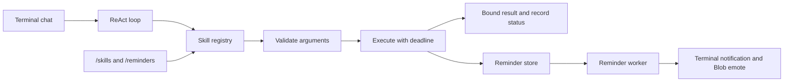

# 🏗️ System Architecture

> Technical architecture documentation for Project Blob

The C++ overlay renders a small expressive slime and receives emotes over gRPC.
Conversation uses the Python backend terminal or an authenticated reconnecting
client. The backend loads declarative skill pills; command tools use approved
read-only folders in a Bubblewrap namespace. Linux user services handle login
startup and crash recovery. See [desktop lifecycle](desktop_privacy.md).

---

## High-Level Architecture

Project Blob is a two-process desktop application:

```
┌─────────────────────────────────────────────────────────────────────────┐
│                           User's Desktop                                │
│                                                                         │
│  ┌──────────────────────────┐     gRPC      ┌──────────────────────────┐│
│  │  C++ Frontend Overlay    │◄─────────────►│  Python AI Backend       ││
│  │  (Process 1)             │  TCP / socket  │  (Process 2)             ││
│  │                          │  Bidirectional │                          ││
│  │  • SDL2 Window Manager   │  Streaming     │  • Nebius-hosted LLM     ││
│  │  • SDL2 Renderer         │               │  • Input Guardrails      ││
│  │  • Blob State Machine    │  ◄─ Emotes    │  • Hermes Agent Tasks    ││
│  │  • Spring-Mass Physics   │  ◄─ States    │  • ChromaDB Memory       ││
│  │  • Drag-Drop Handler     │  Events ──►   │  • Privacy Shield        ││
│  │  • System Tray           │               │  • Screen OCR Sampler    ││
│  │  • Facial Expressions    │               │  • Restricted Skills     ││
│  └──────────────────────────┘               │  • Skill Registry        ││
│                                              │  • Nebius Burst (opt-in) ││
│                                              └──────────────────────────┘│
└─────────────────────────────────────────────────────────────────────────┘
```

---

## Process Architecture

### Why Two Processes?

1. **Crash Isolation**: If the Python AI backend OOMs or crashes, the C++ overlay stays alive and shows Blob in a sleeping state. The user never sees a crash — just a sleepy blob that wakes up when the backend reconnects.

2. **Performance Isolation**: The C++ frontend targets 60 FPS. The Python backend can wait on cloud inference without blocking the overlay's event loop.

3. **Security Boundary**: The frontend never touches the LLM, memory store, or screen captures directly. All sensitive operations are contained in the backend process.

4. **Independent Development**: Frontend and backend can be developed, tested, and deployed independently.

### IPC Protocol

Communication uses **gRPC bidirectional streaming** over `localhost:50051` by
default. The address is configurable and can also be a Unix domain socket.

- **Frontend → Backend**: Dropped attachment paths, user interactions, skill pill drops, heartbeats
- **Backend → Frontend**: Emote commands, notifications, skill acknowledgments, privacy shield events

See [`proto/blob_service.proto`](../proto/blob_service.proto) for the full protocol definition.

---

## C++ Frontend Architecture

```
┌─────────────────────────────────────────────┐
│              main.cpp (Entry Point)          │
│  • Parse args  • Init SDL2  • Run loop      │
├─────────────┬───────────────┬───────────────┤
│   overlay/  │     blob/     │     ipc/      │
├─────────────┼───────────────┼───────────────┤
│ Window      │ StateMachine  │ GrpcClient    │
│ • Transparent│ • FSM states │ • Bidir stream│
│ • Always-top│ • Transitions│ • Reconnect   │
│ • Shape mask│ • Timers     │ • Reconnect   │
│             │               │               │
│ Renderer    │ Physics       │ EventQueue    │
│ • SDL2      │ • Spring-mass│ • Thread-safe │
│ • Gradient  │ • Verlet     │ • Queue       │
│ • Faces     │ • Collision  │               │
│             │               │               │
│ Input       │ Animation     │               │
│ • Mouse     │ • Interpolate│               │
│ • Drag-drop │ • Eye moods  │               │
│ • Gestures  │ • Timers     │               │
│             │               │               │
│             │ Expressions   │               │
│             │ • Face       │               │
│             │ • Blink      │               │
├─────────────┴───────────────┴───────────────┤
│                    ui/                       │
│               SystemTray                    │
│             • Optional X11 icon            │
└─────────────────────────────────────────────┘
```

### Render Loop

```
while (running) {
    1. Poll SDL events → InputHandler
    2. Process IPC events from EventQueue (non-blocking)
    3. Update StateMachine (dt)
    4. Update Physics (dt)
    5. Update Animations (dt)
    6. Clear framebuffer (transparent)
    7. Render blob mesh (Physics → Renderer)
    8. Render the current facial expression
    9. Present frame and update the shape mask
    10. Cap to 60 FPS (sleep remaining time)
}
```

---

## Python Backend Architecture

```
┌─────────────────────────────────────────────┐
│              main.py (Entry Point)           │
│  • Load config  • Start services  • Asyncio │
├──────────────────────────────────────────────┤
│                  ipc/                        │
│  Server (gRPC)  │  EventDispatcher           │
│  • Bidirectional│  • Route events            │
│  • Multi-client │  • Broadcast to frontends  │
├──────────────────────────────────────────────┤
│                   ai/                        │
│  LLMEngine      │  Orchestrator  │ Guardrails│
│  • Local vLLM   │  • Reasoning   │ • NemoClaw│
│  • Nebius API   │  • Memory RAG  │ • Input   │
│  • Streaming    │  • Emote pick  │ • Output  │
│                 │  • Proactive   │ • Privacy │
├──────────────────────────────────────────────┤
│                 memory/                      │
│  VectorStore    │  Episodic  │ Middle / Long │
│  • ChromaDB     │  • Archive │ • Exact quotes│
│  • Collections  │  • 7d chat │ • Expiry      │
│                 │            │              │
│                 Decay Algorithm              │
│  • Relevance gate and age decay             │
│  • Long-term facts are pinned               │
├──────────────────────────────────────────────┤
│  privacy/       │  screen/     │  skills/    │
│  Shield         │  Sampler     │  Registry   │
│  • Monitor      │  • Capture   │  • Load     │
│  • Blacklist    │  • OCR       │  • Validate │
│  • Debounce     │  • Analyze   │  • Execute  │
│                 │  • Delete    │  • Hot-reload│
├──────────────────────────────────────────────┤
│                 agents/                      │
│  HermesAgent    │  OpenShell                 │
│  • Plan-Act     │  • Sandbox                 │
│  • Observe      │  • Restrict                │
│  • Reflect      │  • Audit                   │
└──────────────────────────────────────────────┘
```

### Async Task Model

The backend runs on a single `asyncio` event loop with concurrent tasks:

```python
async def main():
    # Core services (always running)
    grpc_server = start_grpc_server()
    privacy_monitor = start_privacy_shield()      # polls every 500ms
    screen_sampler = start_screen_sampler()        # runs every 30-60s
    memory_consolidator = start_memory_timer()     # runs every 10 min
    heartbeat = start_heartbeat()                  # sends pong every 5s
    
    # Wait for shutdown
    await asyncio.gather(
        grpc_server, privacy_monitor, screen_sampler,
        memory_consolidator, heartbeat
    )
```

---

## Model serving

The backend uses three Nebius model roles: NVIDIA `nvidia/nemotron-3-super-120b-a12b` for chat, tool planning, and text-only document answers (`BLOB_MODEL_NAME`); NVIDIA `nvidia/Nemotron-3_5-Lightning` for background memory consolidation (`BLOB_MEMORY_MODEL_NAME`); and `zai-org/GLM-5.3-Flash` for image inputs and rendered PDF pages (`BLOB_VISION_MODEL`). Super is text-only. Each engine shares the same privacy controller. Lightning receives numbered user-authored statements and selects lasting or expiring memories; original quotes, source provenance, and `consolidation_model` are stored locally. Failed selections leave episodes pending for a later retry. Memory search and tool execution remain local. Manual privacy pause and cloud-off settings guard all three routes. The NemoClaw/Hermes/OpenShell compatibility names elsewhere in older diagrams are not working integrations; the active task loop is in the orchestrator.

### Proposed GPU hosting

The diagram below describes a possible local GPU and cloud routing design. The current NVIDIA integration is the hosted memory role described above.

```
┌─────────────────────────────────────────────┐
│              NVIDIA Stack                    │
│                                              │
│  ┌─────────────┐    ┌──────────────────┐    │
│  │ Nemotron-3   │    │ Nebius Serverless │    │
│  │ Nano (4B)    │    │ (Cloud Burst)    │    │
│  │              │    │                  │    │
│  │ Local GPU    │    │ Ultra/Super/70B  │    │
│  │ vLLM/llama   │    │ OpenAI API       │    │
│  └──────┬───────┘    └────────┬─────────┘    │
│         │                     │              │
│         └─────────┬───────────┘              │
│                   ▼                          │
│         ┌──────────────────┐                 │
│         │    NemoClaw       │                 │
│         │ • Input guards   │                 │
│         │ • Output guards  │                 │
│         │ • Privacy router │                 │
│         └────────┬─────────┘                 │
│                  ▼                           │
│         ┌──────────────────┐                 │
│         │  Hermes Agent     │                 │
│         │ • Plan-Act loop  │                 │
│         │ • Skill registry │                 │
│         │ • Sub-agents     │                 │
│         └────────┬─────────┘                 │
│                  ▼                           │
│         ┌──────────────────┐                 │
│         │   OpenShell       │                 │
│         │ • Landlock LSM   │                 │
│         │ • seccomp-BPF    │                 │
│         │ • Network NS     │                 │
│         └──────────────────┘                 │
└─────────────────────────────────────────────┘
```

---

## Data Flow Diagrams

### User Message Flow

```
User types message
    ↓
Python backend terminal → BlobOrchestrator
    ↓
GuardrailsEngine.sanitize_input()
    ↓
SemanticMemory.recall(query)  →  relevant memories
    ↓
PromptTemplates + skills + context + memory + message
    ↓
NebiusEngine.generate_from_messages()
    ↓
GuardrailsEngine.sanitize_output()
    ↓
EpisodicMemory.capture(interaction)
    ↓
Orchestrator extracts the emote tag
    ↓
Response prints in the terminal; emotes and notifications are broadcast
    ↓
gRPC EventStream → Frontend
    ↓
Renderer draws Blob's facial expression
```

### Attachment flow

The SDL overlay groups each drag-and-drop operation into one `AttachmentDrop`
event and forwards its local file paths over the existing gRPC stream. Skill
files keep their separate installation flow. The orchestrator validates and
analyzes the dropped files, prints an overview in the terminal, and retains the
selected paths for subsequent terminal questions. Drops add unique files to the
current selection; invalid batches leave the previous selection intact.
`/files`, `/files remove <number>`, and `/files clear` manage that selection.
File drops and terminal messages share a lock so their context changes occur in
order. Explicit control and tool requests keep their ordinary handling.

`AttachmentReader` validates file counts, types, sizes, page counts, and decoded
image dimensions. PDFium text extraction and rendering run in a worker thread,
under a shared lock because PDFium cannot run concurrently across threads. Text
excerpts keep page numbers. Page and image payloads are resized and encoded in
memory without original image metadata. The prompt budget counts image context
separately from base64 transport bytes. The model receives documents as source
material and cannot execute tools through the attachment analysis path.

Nebius model discovery checks the provider's input modality and keeps the selected
chat model when it accepts images, otherwise selects an available vision model;
`BLOB_VISION_MODEL` can override
or disable discovery. With no vision model, local OCR supplies text only.
Attachment analysis stays outside episodic storage and memory consolidation.
User-authored terminal messages take a separate path: save a user-only episode
before calling the provider, then immediately index explicit subject/program
declarations as grounded middle-term quotes. Synthetic file-drop overviews do
not enter personal memory. Privacy-shield checks apply to these writes.

File prompts reserve space for bounded recalled user statements before budgeting
source evidence. Active academic declarations are looked up by topic rather than
relying on similarity between a weekday question and subject names. Grounded
related facts and recent user-only episodes fill remaining personal-context space;
old assistant analyses never supply user facts. New declarations supersede older
ones using source timestamps, including when consolidation runs out of order.
Academic quotes expire after 30 days. Startup backfills explicit declarations from
existing user-authored archives without resetting their age. An archived question
or assistant's branch inference cannot supersede a user declaration.

Saved subjects also rank PDF pages and excerpt locations; explicit requested page
ranges still take precedence. Subject lists constrain eligible course rows even
when a program default conflicts. Personal exam questions with no known selector
produce a clarification instead of an unsupported branch assignment.

`DocumentLibrary` saves the exact validated bytes read by `AttachmentReader` in
private directories and indexes filenames and bounded source excerpts in SQLite.
It holds up to 20 documents / 200 MB under `BLOB_DOCUMENTS_DIR_PATH`, defaulting
to `~/.blob/documents/`. Replacing a source at the same original path updates its
record and removes the superseded copy; quotas never silently evict older files.
When no files are active, relevant terminal questions search the saved index by
filename and excerpt words and reopen matching sources for fresh analysis. Cached
sources keep original filenames for citations and are checked against stored
size and SHA-256 before reopening. Full files remain available for new page
requests even when earlier excerpts omitted them. Search is lexical and limited
to indexed excerpts, not a full-document semantic index. Ambiguous references
offer saved choices; `/files saved`, `/files open <id>`, and `/files forget <id|all>`
provide explicit controls. Answers do not become document evidence or user-stated
personal facts. Earlier versions stored no
document copies, so their old sessions cannot be migrated.

`ResultLibrary` stores completed user-requested file answers in a separate private
SQLite database inside `BLOB_MEMORY_DB_PATH`. Records keep the request, answer,
source names/original paths/checksums, creation time, and user-context snapshot.
They survive source deletion; automatic file-drop overviews are excluded, and
privacy-shield checks pause result writes. Saving a new version of the same
timetable updates that result, while unrelated answers remain separate. Storage
quotas report failure rather than discarding existing work.

`/files forget` only deletes source copies and removes their source-only recent
overviews. It preserves completed results and unrelated conversation. `/results`
lists saved work, `/results show <id>` replays the exact answer locally, and
`/results forget <id|all>` deletes generated work and its associated live turns.
With no relevant source, matching questions use saved-work context in a separate
model path that does not claim fresh PDF access or execute tools. Fresh clocks
replace old countdowns; current user declarations override earlier work. A
changed source checksum prevents old work from taking precedence over a revised
PDF. The source must be reattached for details absent from any retained answer.

### Screen Context Flow

```
User asks about the screen, requests simpler study help, corrects the source,
or enters /screen or /screenshot
    ↓
Orchestrator selects the screen path before active attachments or saved recall
    ↓
SkillRegistry.execute("screen_capture", {}, source="terminal")
    ↓
Privacy checks → ScreenSampler.capture() → PIL Image (in-memory)
    ↓
Worker reads OCR, excludes Blob's chat terminal, and closes the image
    ↓
Capture or OCR failed? ──YES──► Report the actual reason; no PDF fallback
    ↓ NO
Fresh active window title and OCR text become the latest model observation
    ↓
Model explains the current material; previous PDFs and access denials are history
    ↓
BackendEvent → Frontend → Animation
```

Screen intent recognizes a screen reference and requests for help or simplification
in either order, including "stuff on my screen ... dumb it down" and corrections
such as "No, the screen, not the PDF." The entry point gives this intent priority
even when a message carries attachment paths. An explicit refusal or a question
about how capture works does not trigger a screenshot. Follow-up authorization
uses the same intent detector. Regression tests combine these requests with
active and saved timetables, detachment, real skill execution with test captures,
and privacy, portal, and OCR failures.

### Skill Pill Ingestion Flow

The runtime loads both built-ins and installed tools into `SkillRegistry`.
`prompt_text()` exposes their argument contracts to the existing ReAct loop;
camera operations stay in the explicit command path. All execution goes through
`SkillRegistry.execute()`, which validates arguments, applies a deadline, bounds
the result, and retains operational metadata in a 30-entry session history.
`/skills` and `/reminders` use this same registry without a cloud model call.

Reminders use a private SQLite store and one asynchronous worker. Creation is
committed before success is returned. Startup reloads pending due times; shutdown
cancels the worker and closes the database without deleting pending reminders.
Recurring notifications advance to the next future interval after downtime.



```
User drags .skill.yaml onto Blob
    ↓
SDL_DROPFILE event → InputHandler
    ↓
FrontendEvent.SkillPillDrop { file_path, hash }
    ↓
gRPC → Backend
    ↓
SkillValidator.validate(file)
    ↓
┌─ Invalid  →  SkillAcknowledgment { success: false, error }
│                 →  CONFUSED emote
│
└─ Valid    →  SkillRegistry.install_file(skill)
                  →  Persist validated YAML; expose tool contracts
                  →  SkillAcknowledgment { success: true }
                  →  EATING emote
    ↓
Frontend plays eating animation
Skill color metadata remains informational
```

---

## Performance Budget

| Component | CPU Target | RAM Target | GPU Target |
|-----------|-----------|-----------|-----------|
| C++ Overlay (idle) | < 0.5% | < 30 MB | < 0.5% |
| C++ Overlay (animating) | < 2% | < 50 MB | < 1% |
| Python Backend (idle) | < 1% | < 200 MB | 0% |
| Python Backend (inference) | < 5% | < 500 MB | 80-100% (GPU) |
| Screen Sampler (per capture) | < 3% spike | < 50 MB spike | 0% |
| ChromaDB (query) | < 1% spike | < 100 MB | 0% |

### Optimization Strategies

1. **60 FPS Cap**: Frontend sleeps between frames to minimize CPU
2. **Lazy Loading**: OCR models loaded only on first screen capture
3. **Batched IPC**: Events are batched per frame, not sent individually
4. **Memory Pooling**: Physics vertices reuse pre-allocated buffers
5. **Async Everything**: Backend uses asyncio to avoid blocking
6. **Model Caching**: LLM stays resident in GPU memory between queries
