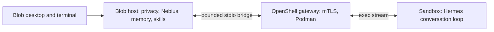

# OpenShell transport

Blob supports an opt-in OpenShell **0.1.4** transport for the pinned Hermes
worker. The gateway uses rootless Podman on Linux. This is separate from the
legacy `OpenShellSandbox` command-policy compatibility class and does not
require the NemoClaw onboarding wizard.

The development installation has enabled this transport and installed the
gateway user service. Its running backend reports a ready worker in an active
sandbox. See [verification results](evals/openshell.md).



The sandbox receives selected conversation context and tool schemas, so those
messages cross a local sandbox boundary. Provider keys, personal memory stores,
camera and screen hardware, host folders, IPC tokens, and gateway client keys
remain on the host. No host directory is mounted into the sandbox. Every model
request and tool call returns through Blob's existing privacy checks and skill
authorization. Inference continues through the configured Nebius client.

`deploy/openshell/policy.yaml` requires Landlock, runs as UID/GID 1000, permits
writing only `/tmp`, and has no network rules. The adapter rejects a policy that
relaxes these requirements. The image contains the pinned Hermes source and two
worker files; the build tool excludes untracked files, `.env`, host memory and
Git configuration. Hermes native tools, plugins and background review remain
disabled. Temporary task profiles are cleared between turns.

## Set up the local gateway

Linux requires Podman 5.x, cgroups v2, and its user API socket. The local installer
downloads the official CLI/gateway archives, verifies pinned SHA-256 digests,
and installs under `.runtime/openshell/bin`. It does not require sudo. The image
build downloads the Python base image and Hermes dependencies.

From the repository root, after installing the pinned Hermes source as described
in [agent_runtime.md](agent_runtime.md):

```bash
venv/bin/python tools/install_openshell_runtime.py
systemctl --user start podman.socket
venv/bin/python tools/build_openshell_image.py
venv/bin/python tools/openshell_gateway.py prepare
venv/bin/python tools/openshell_gateway.py run
```

Leave the gateway running. In another terminal:

```bash
venv/bin/python tools/openshell_gateway.py register
venv/bin/python tools/openshell_gateway.py status
venv/bin/python -m blob.evals.openshell --local-gateway --startup-timeout 600 \
  --output /tmp/blob-openshell-eval.json
```

`prepare` generates local mTLS certificates with OpenShell itself and validates
the gateway configuration. The gateway listens on `127.0.0.1:17670`; plaintext
service routing is disabled. Gateway databases, TLS files and CLI registration
live under `.runtime/openshell`. Initial sandbox creation also downloads
OpenShell's trusted supervisor and sandbox runtime images.

The evaluation uses real OpenShell and Hermes with synthetic replies. It checks
non-root execution, read-only code, blocked network, seccomp, no new privileges,
host tool mediation, warm-worker reuse, per-turn history/permissions, cancellation,
and confirmed sandbox shutdown. It makes no cloud request and uses no personal
documents, memories or hardware. A failed check does not enable the transport.

## Select the transport

After the evaluation passes, add absolute project paths to `.env`:

```dotenv
BLOB_AGENT_RUNTIME=hermes
BLOB_HERMES_TRANSPORT=openshell
BLOB_OPENSHELL_CLI=/absolute/path/to/ProjectBlob/.runtime/openshell/bin/openshell
BLOB_OPENSHELL_GATEWAY=blob
BLOB_OPENSHELL_CONFIG_DIR=/absolute/path/to/ProjectBlob/.runtime/openshell/config
BLOB_OPENSHELL_IMAGE=localhost/blob-hermes:783637e3
```

Restart Blob. `/agent` reports the selected transport, readiness, current sandbox
name and cleanup state. `sandbox_active` becomes true only after the sandbox
has been created and its worker completes the bridge handshake. Passive doctor
output never reports an active sandbox merely because OpenShell is installed.
`blob-agent doctor --probe` exercises the selected transport and closes it.

For desktop startup, the helper can stage a reviewable service and then install
it as a user service. Stop any foreground gateway first:

```bash
venv/bin/python tools/openshell_gateway.py stage-service
venv/bin/python tools/openshell_gateway.py install-service
systemctl --user restart blob-backend.service
```

The service starts the Podman socket and gateway at user login. Its backend
drop-in orders Blob after the gateway. Local features and reminders remain
available when a gateway outage makes Hermes unavailable. For rollback, remove
the helper's `blob-backend.service.d/openshell.conf` drop-in when the gateway is
no longer needed, reload systemd and disable `blob-openshell.service`.

Each backend worker owns a uniquely named sandbox labelled `app=blob-hermes`.
The main process is an idle `sleep`; the worker runs through `sandbox exec` with
no TTY or login-shell startup. This keeps JSON framing intact and avoids the
canonical process's reconnect/replay buffer. No providers are attached and the
remote worker environment is cleared. The sandbox never automatically restarts.

Failure, timeout, cancellation and normal shutdown kill the local exec transport,
stop the dedicated remote sandbox, wait for `Stopped`, and request deletion.
If stopped state cannot be confirmed, cleanup remains pending and the adapter
refuses to create another worker. A failed request is never replayed through a
replacement sandbox or the local engine. If deletion is accepted asynchronously
after confirmed stop, status identifies pending deletion; the worker is stopped.

For rollback, set `BLOB_HERMES_TRANSPORT=local` and restart Blob. Keep the gateway
running until any reported pending sandbox cleanup has been resolved.

## Inspect and troubleshoot

The helper targets only the project-local `blob` gateway:

```bash
venv/bin/python tools/openshell_gateway.py cli sandbox list --output json
venv/bin/python tools/openshell_gateway.py cli sandbox get <name> --output json
venv/bin/python tools/openshell_gateway.py cli logs <name>
venv/bin/python tools/openshell_gateway.py cli sandbox stop <name>
venv/bin/python tools/openshell_gateway.py cli sandbox delete <name>
```

Use the specific sandbox name in `/agent` when cleanup is pending. The adapter
stops only sandboxes it created. A gateway crash or disconnect can leave a frozen
workload; inspect and stop it after restoring the gateway, rather than retrying
an action whose host tool receipt shows success. OpenShell logs and its lifecycle
database have their own retention separate from Blob's memory controls.

The Python image tag and transitive dependency resolution can change on a future
rebuild. The Hermes revision and OpenShell binary hashes are pinned; this is not
a complete dependency lock. Rebuild the image when either worker file changes.

References: [OpenShell installation](https://docs.nvidia.com/openshell/about/installation),
[sandbox exec and lifecycle](https://docs.nvidia.com/openshell/how-it-works/sandboxes/overview),
[policy schema](https://docs.nvidia.com/openshell/how-it-works/policies/schema),
[v0.1.4 release](https://github.com/NVIDIA/OpenShell/releases/tag/v0.1.4).
